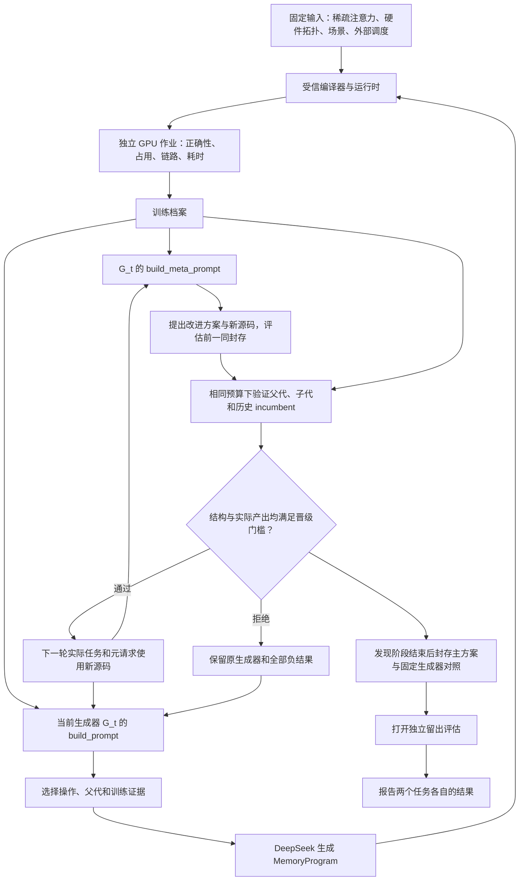

# 两项任务如何连接

TopoMem 把注意力实现、硬件及拓扑、应用请求和外部调度封存为输入。内存程序决定允许的存储行为；递归循环改变产生这些程序的搜索策略。每个阶段都有独立的源码、输入、效果台账和回执摘要。

`build_prompt` 选择构造、变异或交叉，以及实际父代、训练反馈和规则焦点。`build_meta_prompt` 选择下一次修订的模式和证据。同一次元模型响应返回改写两个入口的 `source` 和结构化 `plan`。子代评估前，控制器落盘方案及候选源码摘要，关联所选训练证据。方案记录观察、机制改动、预期和证伪条件。新源码只有在晋级后才成为下一轮的活动版本。后续任务调用与元调用都记录活动源码摘要，能够核实递归链实际发生。

模型不能改写裁判、计时范围、硬件预算、外部调度或留出集合。运行时原语、编译优化和服务接线的人工改动分别登记为工程版本。当前 SGLang 全驻留原语属于这一类工程改动；后续模型可以选择该原语，其提出者身份仍保留。

## 三个分别回答的问题

| 问题 | 判断依据 |
| --- | --- |
| 产出的显存管理是否有效？ | 选中 KV 与输出正确、容量和生命周期合法；在独立留出回放中与固定原生及手写对照配对比较。 |
| 新生成器是否优于当前生成器？ | 两个入口实际改变行为；同量候选槽下，子代相对当前父代和共同历史 incumbent 均达到预定验证门槛。等价编译结果不能用计时波动支持晋级。 |
| 递归机制是否带来额外收益？ | 与保留原生成器、拥有同量调用及候选预算的固定臂比较封存产出，并检查下一轮真实请求是否复用晋级源码。 |

源码改写、源码晋级和最终性能收益使用不同字段。历史 CUDA v7 的一次晋级恢复了当时的历史最佳行为；后续确有九次调用复用该源码，但最终方案仍慢于原生参考。现有严格协议把历史 incumbent 单独列为配对对照。原记录继续保留，不按新协议改写旧结论。

配对区块重复测量的是已经选定的内存程序。十二个执行区块不等于十二次独立的模型生成，也不能当成十二个独立 RSI 搜索种子。这里可以判断一份产物在固定回放中的执行差异；判断生成器能否稳定地产生更好方案，还需要独立重复整个搜索过程，并在未用于改进的新任务上比较产出分布。当前有限次提议和四场景迁移均保留这一统计边界。

## 两类执行后端

| 后端 | 模型可产生的内存决策 | 已固定的外部输入 |
| --- | --- | --- |
| 文本派生 CUDA 块稀疏注意力 | KV 放置、副本、迁移、预取、降级、驱逐、回收；真实多设备张量及生命周期核验。 | 选集、计算位置、请求与分支事件、拓扑及各节点 KV 配额。 |
| 固定 SGLang DSA 回放 | 已资格的热容量、冷层放置，或通过逐用例证明的全驻留冷备份省略。配置在启动时编译，运行中使用原生注意力路径。 | 模型和分词、请求、attention rank、入队组、调度、实际全局批次约束及内存预算。 |

两类结果分别报告。配置中出现第二张 GPU，只说明它是可用输入；实际利用需由每个设备的占用和链路回执证明。SGLang 的双 rank 热缓存、冷主机 payload、CUDA 占位张量、allocator 分配和预留也分别核算。

## 复核入口

- [MemoryProgram 契约](MEMORY_PROGRAM_CONTRACT_ZH.md)：事件、动作、可见特征与运行时职责。
- [RSI 实现调研](RSI_FRAMEWORK_REEVALUATION_20261110_ZH.md)：参考项目、实际检查的版本、可借鉴的机制及边界。
- [resident v2 协议](SG_RESIDENT_V2_ZH.md)：逐用例容量证明、九策略手写对照和封存流程。
- [原始证据说明](../results/EVIDENCE.md)：回执、历史源码和离线重建方式。
